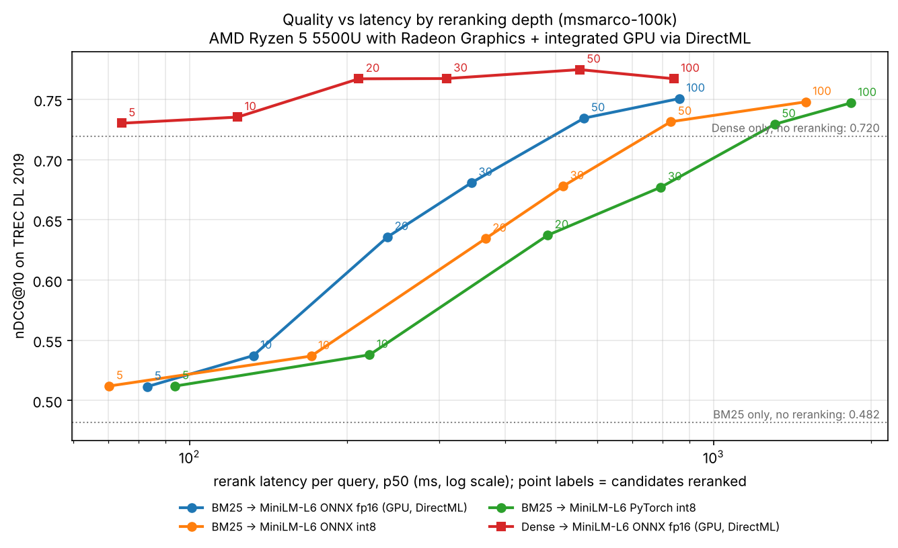

# Large-Scale Search Engine with Neural Ranking

Hybrid retrieval over the MS MARCO passage corpus (8.8M passages): BM25 and dense
retrieval for recall, rank fusion, then a cross-encoder reranker for precision.
Every claim is backed by standard IR metrics, significance tests, and measured
latency percentiles, with the hardware recorded alongside every number.

```text
Query
  ├── BM25 (Elasticsearch)        → top 1000
  └── Dense (bi-encoder + FAISS)  → top 1000
            ↓ Reciprocal Rank Fusion
       top-N candidates
            ↓ Cross-encoder (PyTorch fp32/fp16/int8 or ONNX fp32/int8)
          top 10
```

## Status

| Phase | Scope | State |
|---|---|---|
| 1 | Data pipeline, BM25 (Elasticsearch + local reference, score-level parity), evaluation harness | **done** |
| 2 | Cross-encoder reranking, FastAPI search endpoint | **done** |
| 3 | Dense retrieval (FAISS flat / HNSW / IVF-PQ), RRF hybrid fusion | **done** on 100K subset |
| 5 | Latency: depth sweeps, ONNX fp32/fp16/int8, PyTorch int8, DirectML GPU, cross-machine benchmarks | **done** on one laptop |
| 4 | Cross-encoder fine-tuning with BM25 hard negatives | planned (needs an NVIDIA GPU or cloud GPU) |
| | Full 8.8M-passage corpus | planned (GPU machine for encoding) |

## Results

All on the 100K-passage subset (`msmarco-100k`: every judged passage for the
sampled queries plus a random fill). TREC DL nDCG here is close to full-corpus
values because all judged passages are kept. Machine: AMD Ryzen 5 5500U laptop
(6 cores), integrated Radeon GPU via DirectML. Full reports with hardware
fingerprints: `results/benchmarks/`.

**Retrieval pipelines** (reranker: MiniLM-L6 cross-encoder, ONNX fp16 on the iGPU, 100 candidates)

| Pipeline | DL19 nDCG@10 | DL20 nDCG@10 | DL19 R@100 | DL19 R@1000 |
|---|---:|---:|---:|---:|
| BM25 (Elasticsearch, k1=0.9 b=0.4) | 0.482 | 0.477 | 0.657 | 0.912 |
| Dense (msmarco-MiniLM-L6-cos-v5, exact) | 0.720 | 0.669 | 0.716 | 0.920 |
| Hybrid RRF (BM25 + dense) | 0.675 | 0.612 | **0.745** | **0.949** |
| BM25 → cross-encoder | 0.751 | 0.735 | | |
| Dense → cross-encoder | **0.767** | 0.748 | | |
| Hybrid → cross-encoder | 0.766 | **0.749** | | |

- Reranking BM25 candidates: +0.270 nDCG@10 on DL19 (95% CI [+0.20, +0.34], p < 1e-4).
- Hybrid fusion raises recall@1000 over BM25 significantly (+0.037, p = 0.008), but
  its own top 10 is worse than dense alone: RRF weights a much weaker BM25 equally.
  It is a candidate generator, not a ranker.
- Better candidates help the reranker: +0.015 nDCG@10 over BM25 candidates, same
  direction on both sets, but borderline. Pooled DL19+DL20 (n = 97): dense
  candidates p = 0.061, hybrid p = 0.043; with a Bonferroni correction for the two
  comparisons (alpha = 0.025) neither is significant.
- The bi-encoder was trained on MS MARCO, so dense retrieval is in-domain here;
  BM25's value is expected to be larger out of domain (BEIR).



*Each curve is one pipeline; each point is how many candidates the reranker sees.
Dense candidates (red) reach the BM25 pipelines' best quality at a fraction of the
latency. Same chart for DL20: [docs/tradeoff_dl20.png](docs/tradeoff_dl20.png).*

**Operating points: quality vs latency** (fp16 reranker on the iGPU; mean of DL19 and DL20 nDCG@10)

| Pipeline | Mean nDCG@10 | Rerank p50 |
|---|---:|---:|
| BM25 → reranker @100, PyTorch fp32 on CPU (starting point) | 0.743 | 2,059 ms |
| BM25 → reranker @100 | 0.743 | 860 ms |
| **Dense → reranker @20** | **0.744** | **210 ms** |
| Dense → reranker @30 | 0.749 | 309 ms |
| Dense → reranker @50 | 0.758 | 555 ms |
| Dense → reranker @100 | 0.758 | 840 ms |

Dense candidates put relevant passages near the top, so reranking 20 matches the
starting pipeline's quality at ~9x lower latency (first stage: ~16 ms with HNSW,
which returns 99.6% of exact search's top 10). Beyond 50 candidates there is no
gain. Depths were not tuned on held-out queries, so the 20/30 points are the safe
claims (their advantage is latency, not a test-set peak).

**Reranker latency per query** (100 candidates unless noted; p50)

| Variant | Device | DL19 nDCG@10 | Latency |
|---|---|---:|---:|
| PyTorch fp32 | CPU | 0.752 | 2,059 ms |
| PyTorch dynamic int8 | CPU | 0.747 | 1,835 ms |
| ONNX int8 (ORT 1.31) | CPU | 0.748 | 1,409 ms |
| ONNX fp16 | Radeon iGPU (DirectML) | 0.751 | 916 ms |
| ONNX fp16, 50 candidates | Radeon iGPU (DirectML) | 0.735 | 566 ms |
| ONNX fp16, 30 candidates | Radeon iGPU (DirectML) | 0.681 | 345 ms |

The best variant depends on the hardware: on an AVX-512 Xeon, PyTorch int8 was
fastest (1.8x) and ONNX fp32 slowest (0.47x); on this Zen 2 laptop (no VNNI),
PyTorch int8 gives only 1.12x and ONNX int8 1.46x. ONNX Runtime 1.24 (the
DirectML build) runs the CPU path ~20% slower than 1.31.

Full-corpus sanity references: Anserini BM25 dev MRR@10 ≈ 0.184, DL19 ≈ 0.506,
DL20 ≈ 0.480; MiniLM-L6 model card ≈ 0.743 on DL19.

## Quickstart (Windows; same commands on Linux/macOS)

```bat
python -m venv .venv
.venv\Scripts\activate.bat              :: PowerShell: .\.venv\Scripts\Activate.ps1
pip install -e ".[all]"                 :: GPU machine: install CUDA torch FIRST (see below)
pytest

:: Elasticsearch (Docker Desktop)
docker compose up -d

:: 100K MS MARCO subset (first run downloads ~1 GB via ir_datasets)
python scripts/prepare_data.py --name msmarco-100k --corpus msmarco-passage --eval-sets msmarco-dev dl19 dl20 --n-docs 100000 --n-queries 1000
python scripts/build_index.py --collection msmarco-100k --backend es
python scripts/evaluate.py --collection msmarco-100k --retriever bm25-es
```

### Reranking, latency, and the quality/latency tradeoff

```bat
python scripts/rerank.py --collection msmarco-100k --first-stage bm25-es --depth 100 --eval-sets dl19 dl20
python scripts/depth_sweep.py --collection msmarco-100k --reranked "bm25-es+ms-marco-MiniLM-L-6-v2@100"

:: Faster CPU variants (which one wins depends on the CPU: measure, don't assume)
python scripts/rerank.py --collection msmarco-100k --first-stage bm25-es --depth 100 --eval-sets dl19 dl20 --quantize int8
python scripts/export_onnx.py
python scripts/rerank.py --collection msmarco-100k --first-stage bm25-es --depth 100 --eval-sets dl19 dl20 --model models/ms-marco-MiniLM-L-6-v2-onnx --onnx-variant int8

python scripts/plot_tradeoff.py --collection msmarco-100k --eval-set dl19
```

`depth_sweep.py` gets quality at every depth ≤ 100 from the one depth-100 run
(no extra model calls) and times each depth. `plot_tradeoff.py` draws every sweep
of the collection as nDCG vs latency curves, one per (variant, machine).

### Dense retrieval and hybrid fusion

```bat
python scripts/encode_corpus.py --collection msmarco-100k          :: resumable; GPU used if present
python scripts/build_dense_index.py --collection msmarco-100k --type flat
python scripts/build_dense_index.py --collection msmarco-100k --type hnsw
python scripts/build_dense_index.py --collection msmarco-100k --type ivfpq
python scripts/evaluate.py --collection msmarco-100k --retriever dense --dense-index flat
python scripts/evaluate.py --collection msmarco-100k --retriever hybrid-es
python scripts/compare_runs.py runs\msmarco-100k\dl19\bm25-es.json "runs\msmarco-100k\dl19\rrf(bm25-es+dense-flat-msmarco-MiniLM-L6-cos-v5).json" --metric recall@1000
```

### Search API

```bat
set SEARCH_BACKEND=hybrid-es
uvicorn searchengine.api:app --port 8000
:: http://127.0.0.1:8000/docs  (Swagger UI)
```

Backends: `es`, `local`, `dense`, `hybrid-es`, `hybrid-local`. Reranker via
`RERANK_MODEL` (HF id, local checkpoint, ONNX export dir, or `none`),
`RERANK_QUANTIZE=int8`, `RERANK_ONNX_VARIANT=int8|fp32`.

### Load testing the API

```bat
:: terminal 1
set SEARCH_BACKEND=dense
set DENSE_INDEX=hnsw
set RERANK_MODEL=models\ms-marco-MiniLM-L-6-v2-onnx
set RERANK_ONNX_VARIANT=fp16
set RERANK_DEVICE=dml
set SEARCH_CANDIDATES=20
uvicorn searchengine.api:app --port 8000

:: terminal 2
python scripts/load_test.py --collection msmarco-100k --concurrency 1 2 4 8 --requests 60
```

Real benchmark queries over HTTP at increasing concurrency: client p50/p95/p99,
throughput, and server-side stage times. Results: `results/loadtests/`.

Measured (dense HNSW → MiniLM-L6 ONNX fp16 on the Radeon iGPU, 20 candidates,
load generator on the same laptop):

| Concurrent requests | Throughput | p50 | p95 | Server rerank time |
|---:|---:|---:|---:|---:|
| 1 | 3.1 req/s | 314 ms | 403 ms | 291 ms |
| 2 | 3.5 req/s | 549 ms | 732 ms | 536 ms |
| 4 | 3.1 req/s | 1,255 ms | 1,533 ms | 1,229 ms |
| 8 | 3.2 req/s | 2,537 ms | 2,903 ms | 2,394 ms |

Throughput is flat at ~3.2 req/s while rerank time grows ~linearly with
concurrency: requests queue for the single GPU (DirectML sessions allow one `Run`
at a time, enforced by a lock). Retrieval stays at 15-26 ms. The next lever is
cross-request batching: each GPU call has ~80 ms fixed overhead, so merging the
candidates of several waiting requests into one call should raise capacity.

### Benchmarking across machines

```bat
python scripts/benchmark.py --collection msmarco-100k
python scripts/compare_benchmarks.py
```

`benchmark.py` times every first stage that exists (BM25 ES/local, each FAISS
index, hybrid) and every reranker variant the machine can run (PyTorch fp32,
fp16 on GPU, int8 on CPU, ONNX fp32/int8) on real queries and candidates. Results
go to `results/benchmarks/<hostname>_<time>.json` with the hardware fingerprint
(CPU, cores, GPU, battery state, library versions). Commit them; run the same
command on another machine and `compare_benchmarks.py` prints one table.

### AMD / Intel GPUs on Windows (DirectML)

```bat
pip uninstall -y onnxruntime
pip install onnxruntime-directml          :: from now on: pip install -e ".[all-dml]"
python scripts/export_onnx.py             :: re-export: adds the fp16 variant
python scripts/rerank.py ... --model models/ms-marco-MiniLM-L-6-v2-onnx --onnx-variant fp16 --device dml
```

### NVIDIA GPU machines

Install the CUDA build of PyTorch *before* `pip install -e ".[all]"`. RTX 50-series
(Blackwell) GPUs need CUDA 12.8+ builds:

```bat
pip install torch --index-url https://download.pytorch.org/whl/cu128
```

`--device auto` (the default everywhere) then uses the GPU in fp16 for both the
reranker and the bi-encoder. FAISS stays on CPU (`faiss-cpu`).

### Full corpus (8.8M passages)

```bat
python scripts/prepare_data.py --name msmarco-full --corpus msmarco-passage --eval-sets msmarco-dev dl19 dl20
python scripts/build_index.py --collection msmarco-full --backend es       :: ES heap 4g, Docker memory >= 8 GB
python scripts/encode_corpus.py --collection msmarco-full --batch-size 256 :: GPU: ~1 h; CPU: impractical (~1 day)
python scripts/build_dense_index.py --collection msmarco-full --type ivfpq :: flat would need ~13.5 GB RAM
```

## Layout

```text
searchengine/
  data/          registry (datasets + official metrics), collection format, subset builder, toy data
  text.py        analyzer mirroring ES `english` (BM25 only; neural models get raw text)
  index/es.py    index definition, bulk loading, k1/b updates without reindexing
  retrieval/     Retriever interface; LocalBM25, ElasticsearchBM25, DenseRetriever, RRFHybrid
  dense/         BiEncoder (prefix registry), resumable sharded encoding, FAISS flat/HNSW/IVF-PQ
  ranking/       CrossEncoderReranker (fp32 / fp16 / dynamic int8), OnnxCrossEncoderReranker + export
  pipeline.py    retrieve -> fetch text -> rerank, timed per stage; rerank_run for offline eval
  docstore.py    byte-offset random access to passages (ES backends use _mget)
  eval/          metrics (= trec_eval), randomization test, TREC IO, latency, depth sweep
  envinfo.py     hardware/software fingerprint stored in every report
  api.py         FastAPI /search, /health
  factory.py     builds retrievers / doc sources / rerankers / pipelines from settings
scripts/         prepare_data, build_index, evaluate, rerank, compare_runs,
                 encode_corpus, build_dense_index, export_onnx, depth_sweep, plot_tradeoff,
                 benchmark, compare_benchmarks, load_test, check_analyzer, check_bm25_parity, es_latency_probe
tests/           unit tests incl. tiny randomly initialized models (no downloads)
results/         committed benchmark and load-test results from each machine
docs/            charts used in this README
```

## Design decisions and findings

- **Two BM25 implementations, verified against each other.** Matching Lucene took
  four fixes, each found by measurement (`check_analyzer.py`, `check_bm25_parity.py`):
  UAX#29-style tokenization, Lucene's Porter variant (Martin Porter's reference
  code, not the published algorithm), Lucene's 1-byte document-length
  quantization, and Elasticsearch's `(k1+1)` factor (kept by its
  LegacyBM25Similarity even though Lucene 8 dropped it).
- **`127.0.0.1`, not `localhost`.** On Windows + Docker Desktop, `localhost` added
  ~45 ms to every search request; ES itself needs ~3 ms.
- **Reranking cost is compute-bound and predictable**: MiniLM-L6 is ~21 MFLOP per
  token, ~2.1 GFLOP per (query, passage) pair, ~210 GFLOP for 100 candidates;
  a 6-core laptop CPU sustains ~100 GFLOPS, hence ~2 s per query. The levers are
  fewer candidates, int8, and smaller models; their effect is measured per machine.
- **"ONNX is faster" is not a law.** On one AVX-512 Xeon: PyTorch fp32 1.0x,
  ONNX fp32 0.47x, ONNX int8 1.0x, PyTorch dynamic int8 1.8x. Hence the benchmark
  script rather than a fixed recommendation.
- **ANN recall is measured tie-aware against exact search** (an approximate hit
  counts if its true score reaches the exact k-th score), separating index error
  from model error.
- **Hybrid fusion only helps if both retrievers are decent**: RRF gives rank-based
  votes, so a weak retriever's noise costs the strong one. Measured, not assumed.
- **Run files keep full float precision.** Rounding scores to 6 decimals turned
  close scores into ties and reordered rankings on re-read (caught by the depth sweep).
- **One ES shard** keeps BM25 statistics exact; **subsets keep every judged
  passage**; **official metric conventions per dataset**; **metrics match
  `trec_eval -c`**; **paired randomization tests** for every comparison.

## Contributing

Commit messages follow [gitmoji](https://gitmoji.dev/); see [CONTRIBUTING.md](CONTRIBUTING.md).

## Author

Rishabh Singh · M.Tech, Geoinformatics and Natural Resources Engineering, IIT Bombay
